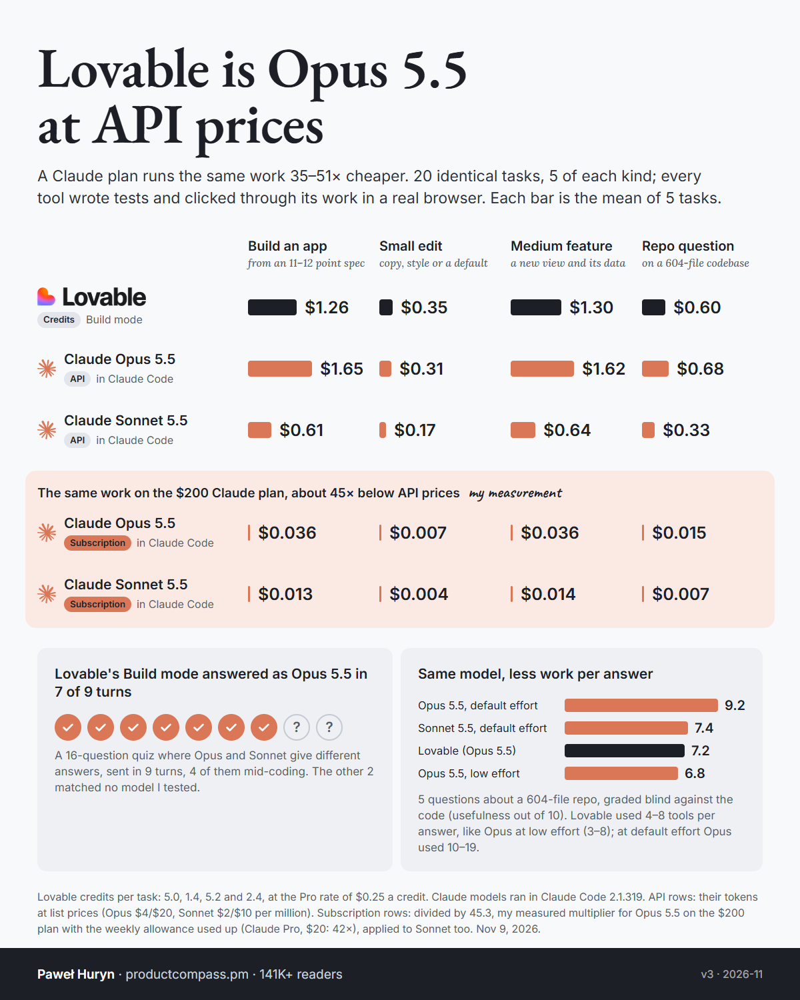

# Lovable vs Claude Code

Lovable builds apps from a chat and charges in credits. Claude Code does the same work in your terminal and, on a Claude plan, charges nothing per task until you hit the plan's limit. This set puts the two side by side on identical work: what each task costs, whether the work is equally good, and which model actually answers inside Lovable.

**The short version.** Lovable's Build mode is mostly Claude Opus 5.5 ([04](04-which-model-answers/)), and per task it charges within 25% of what Claude Code spends on Opus 5.5 at API prices for the same task ([02](02-cost-per-task/)). Lovable isn't marked up much over the model; API prices are what's expensive. On the $200 Claude plan, which gives about 45× more usage than the same money at API prices ([subscription-multipliers](../subscription-multipliers/)), the same work costs 35–51× less than in Lovable, as long as you use the allowance.

| # | Experiment | Question | Headline result |
|---|---|---|---|
| [01](01-pilot/) | Pilot | One task of each size, nobody told to test: what does it cost, and which model family answers? | Without a testing requirement the three sides did visibly different amounts of work, so the comparison needed a rerun. **Chat mode said it was Gemini 2.5 Flash; Build mode answered like Claude 5.x.** |
| [02](02-cost-per-task/) | Cost per task | 15 identical coding tasks, all tested in a real browser: what does each cost in Lovable and in Claude Code? | **A build cost $1.26 in Lovable, $1.65 on Opus 5.5 at API prices and $0.036 on the $200 Claude plan.** Across builds, small edits and features Lovable costs 0.76–1.12× Opus's API price and 35–51× the plan's. All 10 Claude Code apps pass their own 37–94 tests when rerun. |
| [03](03-repo-questions/) | Repo questions | 5 questions about a 604-file open-source repo: cost, and how good are the answers, graded blind? | **Same model, less work: Lovable's answers graded 7.2 for usefulness, Opus 5.5 at default effort 9.2, at low effort 6.8.** Lovable used 4–8 tools per answer, Opus at low effort 3–8, at default 10–19. Per answer: Lovable $0.60, Opus $0.68 at API prices. |
| [04](04-which-model-answers/) | Which model answers | Which Claude tier writes the code in Lovable's Build mode? | **Opus 5.5 in 7 of 9 Build turns, including 3 of the 4 coding turns.** The other 2, both in one project, matched no model tested. No turn matched Sonnet 5.5. |

## What's confirmed, what's likely, what didn't hold

| Claim | Status | Evidence |
|---|---|---|
| Lovable's Build mode runs Claude Opus 5.5 | **Confirmed** for 7 of 9 tested turns, including 3 coding turns | [04](04-which-model-answers/): a 16-question knowledge fingerprint, validated 12 of 12 on the API |
| Lovable costs about what Opus 5.5 costs at API prices | **Measured** | [02](02-cost-per-task/), [03](03-repo-questions/) |
| A Claude plan runs the same work 35–51× cheaper | **Computed** from the measured API-equivalent cost and the measured 45.3× plan multiplier; holds only if you use the allowance | [02](02-cost-per-task/), [subscription-multipliers](../subscription-multipliers/) |
| Lovable's Chat mode is a Gemini Flash-class model | **Highly likely**: it says so, and its knowledge ends in December 2024 | [01](01-pilot/) |
| Lovable routes per project: one project never matched a known model | **Likely**, n = 2 turns in that project | [04](04-which-model-answers/) |
| Lovable sends some turns to a GPT model | **Weak**: 1 of 20 turns, a style signal only | [04](04-which-model-answers/) |
| Lovable's shorter repo answers come from doing less work per answer | **Likely**: its tool use and grades match Opus 5.5 at low effort (n = 5 questions). Whether that's an effort setting or Lovable's own instructions is **unknown** | [03](03-repo-questions/) |
| Sonnet 5.5 and Opus 5.5 can be told apart by knowledge cutoff | **Didn't hold**: both have a June 2026 cutoff | [04](04-which-model-answers/) |
| A wrong-weekday trap separates Sonnet 5.5 from Opus 5.5 | **Didn't hold**: both caught it every time; only Haiku 5.5 missed it | [04](04-which-model-answers/) |
| Lovable is expensive compared with the API | **Didn't hold**: it costs 0.76–1.12× what Opus 5.5 costs at API prices, less on 3 of 4 task types | [02](02-cost-per-task/) |
| Small edits in Claude Code cost a few cents | **Only in short sessions**: 3–5 cents in the pilot, 12–38 cents at API prices inside a long session that resumes the build | [01](01-pilot/), [02](02-cost-per-task/) |

## Production and test data in Lovable (from its docs, not measured)

Not an experiment, but it's the other half of the choice, so here it is with sources, read 2026-11-09:

- **Test and Live are gone.** "Test and Live environments on the built-in backend are retired on October 23, 2026… every project on the built-in backend runs on a single database." ([docs.lovable.dev/features/environments](https://docs.lovable.dev/features/environments))
- **Drafts don't separate data.** A draft "previews app changes rather than providing a second database… the information you add or change while testing is real." ([docs.lovable.dev/features/drafts](https://docs.lovable.dev/features/drafts))
- **Reverting restores code, "not your database data".** ([docs.lovable.dev/features/projects/history](https://docs.lovable.dev/features/projects/history))
- **Hosting, in-app AI and building share one credit balance.** When it runs out, "AI features in deployed apps stop working", and Cloud-backed apps "can pause until credits are added". ([docs.lovable.dev/introduction/credits-and-usage](https://docs.lovable.dev/introduction/credits-and-usage))

Claude Code has no hosting or environments of its own: you bring them (git branches, preview deploys, a separate dev database), and nothing is shared unless you set it up that way. That's the trade: Lovable's price buys hosting, one-click publishing and no terminal; you give up a separate test database.

## Method notes that apply to every experiment

- **The same words to both tools.** Every prompt was identical across Lovable and Claude Code, verbatim in [02-cost-per-task/tasks.json](02-cost-per-task/tasks.json) and in each tool's `prompts/` or `runs/` folder.
- **Equal testing.** Every coding prompt in 02 ended with the same instruction: write tests, run them, and click through every requirement in a real browser at 1280 px and 375 px. Both tools did, by their own logs (Lovable's timeline, Claude Code's tool calls and the screenshots it opened).
- **Claude Code:** version 2.1.319, headless (`claude -p --output-format stream-json`), on a Claude subscription login with no API key in the environment ([scripts/run_cc.py](scripts/run_cc.py)).
  - No MCP connectors (`--strict-mcp-config` with an empty config).
  - Only the project's settings and its 3-line `CLAUDE.md` ([02-cost-per-task/starter/CLAUDE.md](02-cost-per-task/starter/CLAUDE.md)); the user-level `~/.claude/CLAUDE.md` was excluded with `claudeMdExcludes`.
  - Edits auto-accepted; shell limited to npm, npx, node, git and read-only tools.
  - Five sessions ran in parallel on one Windows laptop.
- **Claude Code's cost** is what the session's tokens would cost at Anthropic's API list prices, computed per step from the session's cumulative `modelUsage` ([scripts/analyze_cc.py](scripts/analyze_cc.py)): Opus 5.5 $4 / $20 per million input / output tokens, Sonnet 5.5 $2 / $10, cache reads $0.20 for both, cache writes 2× input (every write in these runs used the 1-hour cache). On the subscription, those dollars weren't billed.
- **Lovable's cost** is credits, read from each turn's Details header, or from the message's "More options" menu for answer-only turns ([scripts/lovable_run.mjs](scripts/lovable_run.mjs)). Dollars at $0.25 a credit (Pro, $25 for 100); top-ups are $0.30. Build mode throughout.
- **On the plan** = API-equivalent dollars ÷ 45.3, the Claude Max 20x multiplier measured in [subscription-multipliers](../subscription-multipliers/) (Opus 5.5 in Claude Code). Claude Pro measured 42×.
- **Re-running.** The Claude Code side reruns from [scripts/run_cc.py](scripts/run_cc.py) with a Claude login; the Lovable side needs a logged-in Chrome with remote debugging on port 9222 and [scripts/lov_chain2.sh](scripts/lov_chain2.sh).

## Caveats that apply to every experiment

- **One account, one day (2026-11-09), five tasks per type.** Lovable can change its routing, prompts and pricing at any time.
- **"Equal quality" means equal instructions and evidence of testing**, plus blind grading of the repo answers. The 15 Lovable apps weren't graded feature by feature against the 10 Claude Code apps; Lovable's code stays in its cloud.
- **The plan comparison assumes you use the allowance.** A plan you barely use costs more per task than its multiplier says; a plan you run out of falls back to extra usage at API prices.
- **Wall-clock times** for Claude Code include five parallel sessions on one laptop; they're slower than a single session would be.
- **A first Claude Code run loaded the user-level `CLAUDE.md`** (a personal notes file, about 2,500 tokens). It was rerun clean for every number here; the first run is filed under `replicate-user-claude-md/` in 02 and 03; per task type its costs were 9% lower to 27% higher than the clean run's (the 5-task ranges overlap), and its Lovable-to-plan ratio was 30–47× instead of 35–51×.

## Anonymization

The bench ran in a temporary folder, shown as `<BENCH>`; Lovable project IDs are shown as `<project>`. The rules are in [../.claude/hooks/anonymize-rules.json](../.claude/hooks/anonymize-rules.json). Lovable page captures keep only the turn's own text: the surrounding page lists the account's other projects, so that part was dropped. Nothing else in the logs was edited. The blind-grading packets in 03 are derived copies, flattened to plain text with clone paths masked, as [scripts/make_blind3.py](scripts/make_blind3.py) shows.
